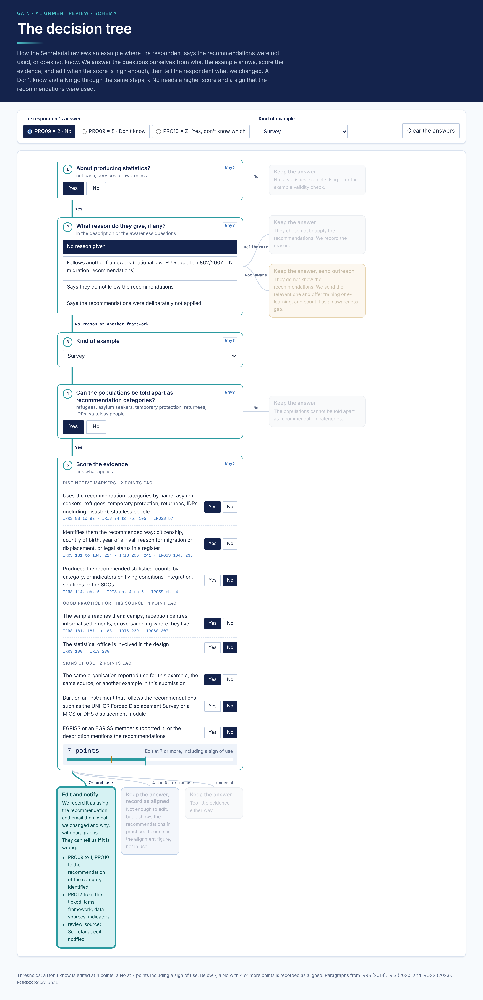

# GAIN alignment review

How the EGRISS Secretariat reviews GAIN examples where the respondent says the recommendations (IRRS, IRIS, IROSS) were not used, or does not know, and decides whether to edit the answer and notify the respondent.



## The tree

1. **About producing statistics?** No: keep the answer, flag for the validity check.
2. **What reason do they give?** None or another framework: continue (another framework adds 1 point). Does not know the recommendations: keep the answer, send outreach. Deliberately not applied: keep the answer.
3. **Kind of example:** register, survey, census, data integration, strategy, guidance, non-traditional source, or event.
4. **Can the populations be told apart as recommendation categories?** No: keep the answer.
5. **Score the evidence:** distinctive markers of the recommendations (2 points each), good practice for the kind of source (1 point each), signs of use (2 points each).

| Answer | Edit and notify | Otherwise |
|---|---|---|
| Don't know (PRO09 = 8) or PRO10 = Z | 4 points or more | keep the answer |
| No (PRO09 = 2) | 7 points or more, including a sign of use | 4 or more: keep, record as aligned; under 4: keep |

The rules are in [`spec/decision_tree.json`](spec/decision_tree.json), implemented in [`src/alignment_rules.py`](src/alignment_rules.py) and tested on hypothetical cases in [`tests/`](tests). Open [`prototype/decision_tree.html`](prototype/decision_tree.html) in a browser to walk through it.

## Run the tests

```
python3 tests/test_rules.py
```

## Try one example

```
python3 src/alignment_rules.py '{"answer":"no","q1":true,"q2":"none","kind":"admin","q4":true,"ticks":["d0","d1","p1","l0"],"populations":"R"}'
```

## Paragraph references

From the International Recommendations on Refugee Statistics (2018), on IDP Statistics (2020) and on Statelessness Statistics (2023). Each criterion in the spec carries its paragraphs.

## Data

No respondent data are kept here. The dashboard reads the GAIN Kobo export and prior rounds; see [`spec/kobo_fields.md`](spec/kobo_fields.md).
